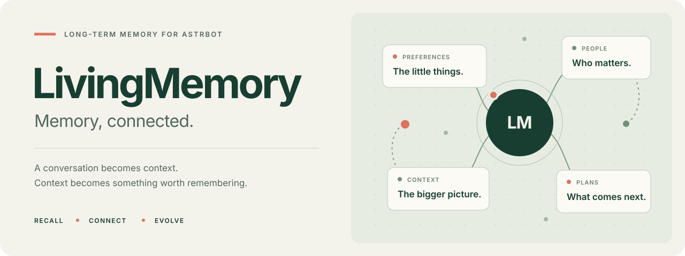

  <a href="README.md">中文</a> · <strong>English</strong> · <a href="README_ru.md">Русский</a>

  <a href="https://lxfight-s-astrbot-plugins.github.io/astrbot_plugin_livingmemory/en/"><strong>Documentation</strong></a> ·
  <a href="https://lxfight-s-astrbot-plugins.github.io/astrbot_plugin_livingmemory/en/webui"><strong>Dashboard</strong></a> ·
  <a href="https://github.com/lxfight-s-Astrbot-Plugins/astrbot_plugin_livingmemory/releases"><strong>Downloads</strong></a> ·
  <a href="https://github.com/lxfight-s-Astrbot-Plugins/astrbot_plugin_livingmemory/issues"><strong>Issues</strong></a>

  
  
  

## Keep what matters from a conversation

LivingMemory gives AstrBot a durable store of preferences, relationships, project progress and past agreements. It summarizes conversations, recalls relevant context through keywords, vectors and a graph, and manages memory through archiving, decay and access reinforcement.

> **Latest stable: 2.8.0** 
> Independent warm-lit 3D graphs with camera focus, associated memories and GPU batches; fixes sandboxed Worker loading and adds the new QQ community group. 
> [Download 2.8.0](https://github.com/lxfight-s-Astrbot-Plugins/astrbot_plugin_livingmemory/releases/tag/2.8.0) · [Releases and upgrades](https://lxfight-s-astrbot-plugins.github.io/astrbot_plugin_livingmemory/en/releases) · [Earlier releases](https://github.com/lxfight-s-Astrbot-Plugins/astrbot_plugin_livingmemory/releases)

## From remembering to recalling

- **Automatic capture** — Summarize conversations after the configured number of turns. Important memories can retain source messages for review and re-summarization.
- **Context-aware recall** — Document and graph routes combine keyword and vector retrieval, rank fusion, scope filtering and lifecycle checks.
- **Agent tools** — `recall_long_term_memory` and `memorize_long_term_memory` let the agent read and write long-term memory when needed.
- **Visible and maintainable** — Browse 2D/3D graphs, zoom into nodes and inspect their memories, edit memories, test recall, manage prompts and inspect system status in official Plugin Views.

## One workspace, four styles

**Editorial** offers green grids and crisp lines; **Studio** uses soft cards; **Paper** pairs warm surfaces with serif headings; **Terminal** combines monospace type with instrument panels.

Every style supports light, dark and automatic modes. Switch from “Appearance” in the dashboard; preferences stay in the current browser. Graph labels settle during zoomed reading, and mobile controls support session filtering and memory focus.

The 3D graph has an independent warm-lit scene with rotation, zoom, node focus and associated memories. GPU batches render large sets of nodes and relationships.

[Explore themes and workflows →](https://lxfight-s-astrbot-plugins.github.io/astrbot_plugin_livingmemory/en/webui)

## Get started

1. Install from the AstrBot plugin marketplace, or place the selected version under `data/plugins/astrbot_plugin_livingmemory`.
2. Create and enable an Embedding Provider in AstrBot's Model Providers → Embedding page first (the free `BAAI/bge-m3` setup is documented [here](https://lxfight-s-astrbot-plugins.github.io/astrbot_plugin_livingmemory/en/guide/embedding-model)), then reload AstrBot and fill in its ID plus the LLM provider in LivingMemory. Leaving the embedding field empty only falls back to the first available provider, which can pick the wrong model or break vector/graph index initialization.
3. Open `Plugins → LivingMemory → Views → dashboard` (`Pages` in older AstrBot releases). Plugin views require **AstrBot 4.24.2 or later**.

For the beta, download the specific tag above and follow [installation and rollback steps](https://lxfight-s-astrbot-plugins.github.io/astrbot_plugin_livingmemory/en/releases). Back up existing plugin data and configuration before upgrading.

After a few conversation turns, use `/lmem status`, `/lmem summarize` and `/lmem search your keywords` to check the pipeline.

## Free embedding model

LivingMemory's semantic recall depends on an Embedding Provider. The free `BAAI/bge-m3` model from SiliconFlow (1024 dimensions) is recommended. In AstrBot's Model Providers → Embedding → Add Model Provider → OpenAI Embedding flow, enter:

- Provider ID: keep the value generated by AstrBot, such as `openai_embedding`
- API Base URL: `https://api.siliconflow.cn/v1`
- API Key: a key created in the SiliconFlow console
- Embedding Model: `BAAI/bge-m3`
- Embedding Dimensions: `1024`

Save and test the provider, then set `provider_settings.embedding_provider_id` in LivingMemory to that Provider ID. The model ID and Provider ID are different; see [Embedding Models and BGE-M3](https://lxfight-s-astrbot-plugins.github.io/astrbot_plugin_livingmemory/en/guide/embedding-model) for the full guide.

## Keep exploring

[Quick start](https://lxfight-s-astrbot-plugins.github.io/astrbot_plugin_livingmemory/en/guide/getting-started) · [Configuration](https://lxfight-s-astrbot-plugins.github.io/astrbot_plugin_livingmemory/en/configuration) · [Commands](https://lxfight-s-astrbot-plugins.github.io/astrbot_plugin_livingmemory/en/commands) · [Architecture](https://lxfight-s-astrbot-plugins.github.io/astrbot_plugin_livingmemory/en/architecture) · [Changelog](CHANGELOG.md)

Upgrading from v1.4.0–v1.4.2? Read the [backup and migration guide](https://lxfight-s-astrbot-plugins.github.io/astrbot_plugin_livingmemory/en/configuration#backup-migration-and-cleanup) first.

---

Community: QQ group 2: `1129994749` (new) · [QQ group 1: 953245617](https://qm.qq.com/cgi-bin/qm/qr?k=WdyqoP-AOEXqGAN08lOFfVSguF2EmBeO&jump_from=webapi&authKey=tPyfv90TVYSGVhbAhsAZCcSBotJuTTLf03wnn7/lQZPUkWfoQ/J8e9nkAipkOzwh) (full) · Password: `lxfight` 
License: [AGPL-3.0](LICENSE)
