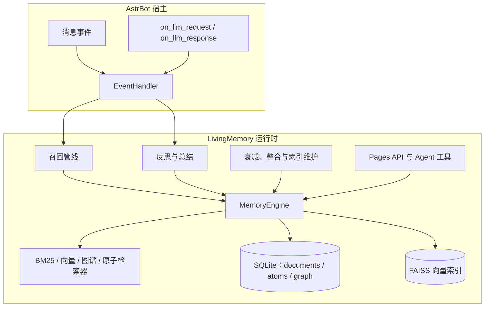
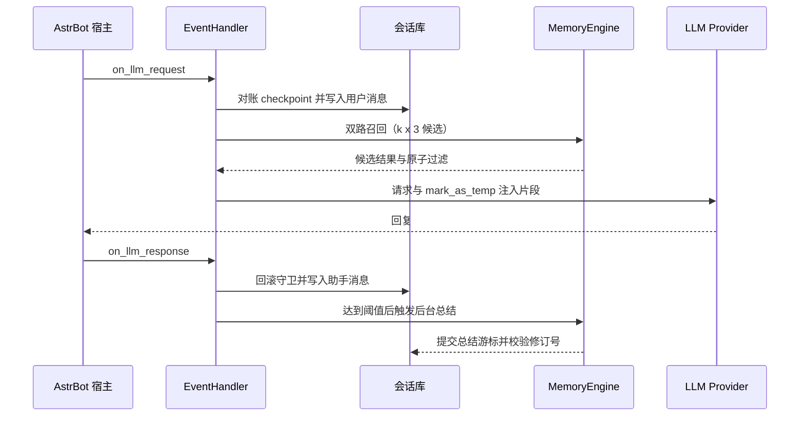
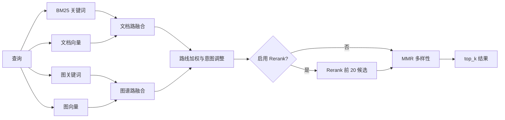
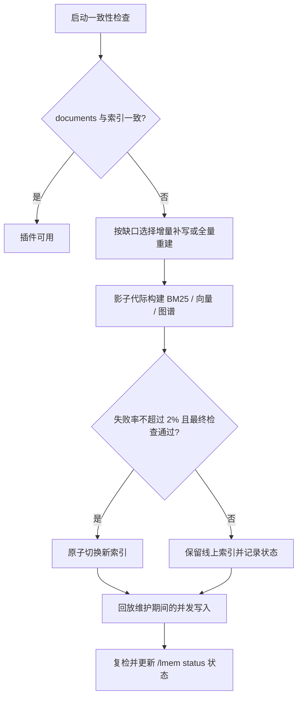

# 技术架构

LivingMemory 把自动记忆与 Agent 主动工具放在同一套数据模型上：会话消息由 `ConversationStore` 保存，长期记忆写入共享的 `documents` 表，细粒度事实写入 `memory_atoms`，图结构写入 `graph_*` 表，所有检索都经过 `MemoryEngine` 的公共 API。本页按运行时顺序说明各层职责与关键取舍，而不是只给出模块图。

## 运行时总览

## 分层与职责

| 层 | 主要实现 | 职责 |
| --- | --- | --- |
| 插件入口 | `main.py` | 注册命令、LLM 钩子与 Agent 工具；元数据来自 `metadata.yaml`；钩子只检查就绪状态，不阻塞宿主事件循环 |
| 初始化编排 | `core/plugin_initializer*.py` | 创建 FAISS/文档存储、检查向量维度、执行数据库迁移、构建引擎与调度器，并在后台完成一致性维护 |
| 请求管线 | `EventHandler`、`memory_recall`、`memory_reflection` | 白名单与作用域检查、历史对账、召回与注入、回复写入与总结触发 |
| 记忆引擎 | `MemoryEngine` | 写入、搜索、更新、删除、访问统计、衰减与整合的统一入口，对外暴露检索器与 `index_writer` |
| 检索与融合 | `HybridRetriever`、`DualRouteRetriever`、`RRFFusion`、`GraphRetriever` | 文档路与图谱路的关键词/向量召回，候选扩展、融合、加权、重排与降级 |
| 存储层 | `storage/` | SQLite 表与索引、FTS、迁移与版本表、FAISS 持久化桥接 |
| 管理与观测 | `pages/dashboard/`、`/lmem` 命令 | Pages API 复用同一套引擎；状态报告暴露初始化与索引维护进度 |

## 启动与关闭

1. AstrBot 加载插件模块后按 `metadata.yaml` 识别插件类；`main.py` 注册命令、LLM 钩子、Agent 工具与 Pages API，然后启动初始化任务。
2. 初始化在后台运行：创建或打开 FAISS 索引与 `documents` 存储并检查向量维度；非 ASCII 路径通过 `faiss_path_bridge` 先写 ASCII 临时目录再原子替换。
3. 数据库版本不足时执行迁移；迁移前必须成功创建备份，任一步失败会恢复备份并终止初始化，向用户返回明确错误。
4. `MemoryEngine` 建立连接（`PRAGMA journal_mode = WAL`、`busy_timeout = 10000`）、创建 `documents` 表与表达式索引、初始化 BM25/向量/图谱/原子检索器、检索缓存与访问统计合并写。
5. 衰减调度器按配置的每日执行小时启动；启动一致性检查作为后台任务运行，插件在检查完成前就进入可用状态。
6. 关闭时停止调度器、取消并等待后台任务（有界等待，超时记录日志），再关闭索引持久化器与数据库连接，避免半写盘。

## 一次请求的完整路径

1. `on_llm_request` 钩子先做就绪检查：初始化未完成时直接跳过召回，不阻塞宿主请求。
2. 检查记忆白名单与作用域可见性；不通过时不会读取或写入这一轮的记忆。
3. 事件携带 `llm_checkpoint_id` 时，先把插件会话库与 AstrBot 的 LLM 历史对账：按快照 ID 删除被回滚的尾部消息，钳制 `last_summarized_index` 与 `pending_summary`，并推进会话修订号。
4. 清理旧注入方式残留在历史中的片段，再把当前用户消息写入会话库。
5. 启用 `inject_with_recent_context` 时用最近对话扩展查询，否则只使用当前消息。
6. 先查检索缓存；未命中则运行双路召回，结果经过原子策略过滤后再格式化。
7. 按字符预算把记忆追加为 `mark_as_temp` 临时内容片段；`extra_user_content` 是唯一支持的注入方式，不写入对话历史。
8. LLM 回复后，`on_llm_response` 钩子执行回滚守卫并写入助手消息；未总结轮次达到阈值时计算窗口、捕获会话修订号并调度后台总结任务。
9. 后台任务写入新记忆并提交总结游标；提交前再次校验修订号，任务被取消或游标提交被拒时会补偿删除刚写入的记忆。

## 双路四模式检索

| 路线 | 关键词模式 | 向量模式 |
| --- | --- | --- |
| 文档路 | `BM25Retriever`（jieba 词元 + 中文连续段字符二元组） | `VectorRetriever`（FAISS） |
| 图谱路 | `GraphKeywordRetriever`（FTS5 trigram，短词回退普通匹配） | `GraphVectorRetriever` |

### 候选扩展与融合

- 文档路与图谱路并行执行；路线内部把 `k × recall_candidate_multiplier`（默认 3）作为候选数，启用重排时至少取 `rerank_candidates`（默认 20）。
- 路线内默认使用分数级融合：两路分数在本查询内 min-max 归一化后按 `fusion_bm25_weight`（默认 0.5）加权；`fusion_mode=rrf` 可退回排名级融合。
- 两路都命中且名次接近时叠加 `fusion_agreement_bonus`（默认 0.25）；随后按 0.5 相关性、0.25 重要性、0.25 时间新鲜度加权，时间权重使用 `importance_decay.decay_rate`（默认 0.01）。
- 可选 Rerank 只处理融合后的前 20 个候选；随后执行 MMR（`mmr_lambda` 默认 0.7）控制多样性，再截断到 `top_k`。
- 路线级融合默认文档路 0.65、图谱路 0.35，并按查询意图调整：关系类词提高图谱权重 0.2，时间类词提高 0.1，定义/解释类词提高文档权重 0.15，最终权重裁剪后归一化；同一记忆被两路同时返回时加 0.08 交叉奖励。
- 任一路线超时或异常时保留另一条路线结果；向量路失败可回退 BM25，图谱路独有结果会批量加载完整正文，避免注入空内容。

### 原子过滤、缓存与预算

- 原子检索参与主召回：只有 `expires_at` 未过期且状态为 active 的原子进入结果；包含原子的记忆只注入有效事实，全部过期时整条记忆被丢弃，而不是注入空文本。
- 检索缓存默认 45 秒失效，写入、更新、删除时主动失效；缓存保存文档级候选，命中后仍会重新执行原子策略，避免注入过期事实。
- 向量候选按需扩取，最多检查 8192 个向量；Embedding 输入按模型限制截断，但完整正文始终保存在 `documents`，查看、导出与重建不受影响。
- 单次注入文本上限 6000 字符，单条记忆最多 800 字符；图节点子串检索依赖 SQLite trigram，三个字符以下的查询走普通匹配。

## 写入与一致性

- 写入统一通过 `MemoryIndexWriter`：先写向量库取得 doc_id，再用同一 ID 写 BM25；BM25 失败时删除已写入的向量，避免残留孤儿向量。
- 随后写图记忆与原子；这两步失败只记录日志，由启动一致性检查与重建对账，不回滚已成功的主文档，避免一次图索引失败丢掉整条记忆。
- 原文消息写入独立的 `memory_sources` 表（JSON），不参与检索；写入失败会删除刚建立的记忆并抛错，保证有记忆必有可追溯原文。
- 删除顺序为 BM25 → 向量 → `documents`；向量删除失败会用备份内容恢复 BM25，文档表删除失败只告警，因为主数据已移除。
- 访问统计不逐条落库：同一批 doc_id 在 3 秒窗口内合并为一次更新，原子访问统计单独合并，减少 `json_set` 与 commit 次数。
- 会话侧使用修订号与写锁：总结任务在读取范围前记录修订号，提交游标时在 store 写锁内按当前消息数钳制并比对修订号；回滚或清空会话会使旧任务失效。

## 存储模型

| 表 | 作用 | 关键设计 |
| --- | --- | --- |
| `documents` | 长期记忆正文与元数据，与 AstrBot 的 DocumentStorage 共享 | metadata 为 JSON；会话、人格、重要性、状态、创建时间均有表达式索引；`doc_id` 唯一 |
| `livingmemory_memories_fts` | 文档全文检索 | FTS5，与 `documents` 同步更新 |
| `memory_sources` | 记忆对应的原始消息 | 独立表，避免原文进入检索与 Embedding |
| `memory_atoms` | 细粒度事实单元 | `ttl_days`、`expires_at`、`status`、`reinforcement_count`、`decay_type`，按状态、过期与作用域建索引 |
| `memory_atoms_fts` | 原子全文检索 | FTS5，过期与遗忘时同步移除 |
| `graph_nodes` | 实体节点 | `node_key`、`node_type`、`canonical_value`，canonical 建索引 |
| `graph_edges` | 实体关系 | 同时按 source/target 节点与来源记忆建索引 |
| `graph_entries` | 图条目 | 保存摘要、关系类型与来源记忆 |
| `graph_entry_nodes` | 条目与节点映射 | 连接图条目与节点，支持多节点条目 |
| `graph_entries_fts` | 图条目全文检索 | FTS5 trigram，支持子串匹配 |
| `db_version` / `migration_status` | 迁移版本与运行状态 | 保存版本、耗时、Provider 指纹与 `needs_index_rebuild` 标记 |
| `sessions` / `messages` | 会话消息库 | 由 `ConversationStore` 管理，与记忆库分离，保存总结游标与修订号 |
| `memory_write_ops` | 旧版写操作日志 | 仅为 v7→v8 迁移兼容保留 DDL，当前代码不再写入 |

## 并发模型

- 进程内单事件循环；SQLite 使用 WAL 与 `busy_timeout = 10000`，写事务集中在 `MemoryEngine` 的单一连接，读多写少场景下减少锁竞争。
- FAISS 使用读者-写者锁：检索在默认线程池中持有读锁，索引变更与落盘持有写锁；落盘由单线程 executor 串行执行并做防抖，保证写入顺序。
- 会话层有独立会话锁与 store 写锁：消息删除、元数据写入、修订号推进和游标钳制在同一临界区完成。
- 缓存有独立锁；失效与重建不会长时间阻塞请求；后台任务通过集合跟踪，完成后回调记录异常。
- 初始化、索引重建、衰减调度都是受控后台任务；卸载时先置位关闭标记，再取消与等待，避免新任务在关闭过程中启动。

## 索引维护

- 启动一致性检查比对 `documents` 与 BM25 文档数、`documents` 与向量 ID 集合，缺失时触发增量补写或全量重建。
- `memory_atoms` 的 FTS 在引擎初始化时按缺失行回填；图记忆重建由 `/lmem rebuild-graph` 或启动维护任务单独执行，二者都复用相同的影子构建流程。
- 保存 Embedding Provider 指纹；Provider 或模型变化即使维度相同也会触发完整向量重建。
- BM25 与向量在影子代际中构建，失败比例不超过 2% 且最终检查通过后才原子切换；完整向量重建保存检查点，中断后可续跑。
- 图记忆使用影子存储流式重建，重建期间的新写入在切换前回放，避免丢更新。
- 启动时若存在迁移遗留或宿主不支持删除向量，会写入 `needs_index_rebuild` 标记，由后台维护消费并在完成后清除。
- 维护状态通过 `MemoryEngine` 暴露，`/lmem status` 展示检查、重建、部分完成、失败或取消及进度。

## 生命周期与遗忘

- 会话达到未总结轮次阈值（默认 10）后触发总结；跨天或长空闲（默认 180 分钟）会把窗口切成最老片段，避免跨天对话合并进一条记忆。
- 长期记忆的 importance 每日按 `importance_decay.decay_rate`（默认 0.01）衰减；窗口内被访问的记忆按访问次数降低有效衰减率，访问次数在每次衰减后乘 0.5，避免旧热点永久保留。
- 原子有类型化 TTL：事件 7 天、计划 2 天、事实 180 天、关系 90 天、偏好 60 天、未知 30 天；importance 与强化次数会放大 TTL，衰减类型分为线性、指数与阶跃。
- 原子状态包括 active、dormant、superseded、expired、forgotten；访问会强化新原子，过期后先软删除再清理，图与 FTS 同步更新。
- 记忆整合按每日或反思触发，按会话或语义聚类（相似度阈值默认 0.7）合并；保留策略为归档或删除，归档可从 Dashboard 恢复。
- 版本备份在插件版本变化时创建，保留 7 天；数据库迁移与高风险批量操作前也会生成备份。

## 作用域与隔离

- 作用域模式有 legacy、session、user、global 四种（`filtering_settings.memory_scope_mode`）；召回、写入与迁移使用同一套作用域解析。
- 白名单控制哪些用户或会话可以捕获、总结与召回；不通过时不会写入记忆。
- 会话、人格与状态过滤在 BM25 与 SQL 查询中完成，并在截断候选前执行，避免先截断再过滤造成漏召回。
- 图条目与原子同样携带 session_id 与 persona_id，跨会话共享只会在 user 或 global 模式下发生。

## 性能预算与已知限制

- 自动召回默认 `top_k=5`、`max_k=10`；每条路线默认 10 秒超时，双路总超时为两倍加一秒。
- 单次注入文本上限 6000 字符，单条记忆 800 字符；Agent 记忆工具默认每次请求 4 次调用、20 秒累计时长、12000 字符返回上限。
- Embedding 重建默认批量 8、并发 1、最多重试 5 次、指数退避基础 30 秒、请求间隔 5 秒，用于适配 TPM 限流。
- 已知限制：异步落盘是防抖的，进程强杀可能丢失最后一次刷盘；trigram 检索依赖 SQLite 编译选项；SQLite 写入仍是单写者，超大批量导入会串行执行。

## 数据安全

| 场景 | 保护措施 |
| --- | --- |
| 插件版本变化 | 启动时创建版本标记备份，保留可配置天数 |
| 数据库迁移 | 迁移前强制备份，失败自动恢复并使用旧库启动 |
| 索引重建 | 影子代际构建，失败保留线上索引，成功后原子切换并回放并发写入 |
| 记忆删除 | 事务删除关联记录；向量删除失败时恢复 BM25，避免半删除 |
| 作用域与注入 | 召回前过滤作用域；注入只追加临时片段，不写入宿主对话历史 |
