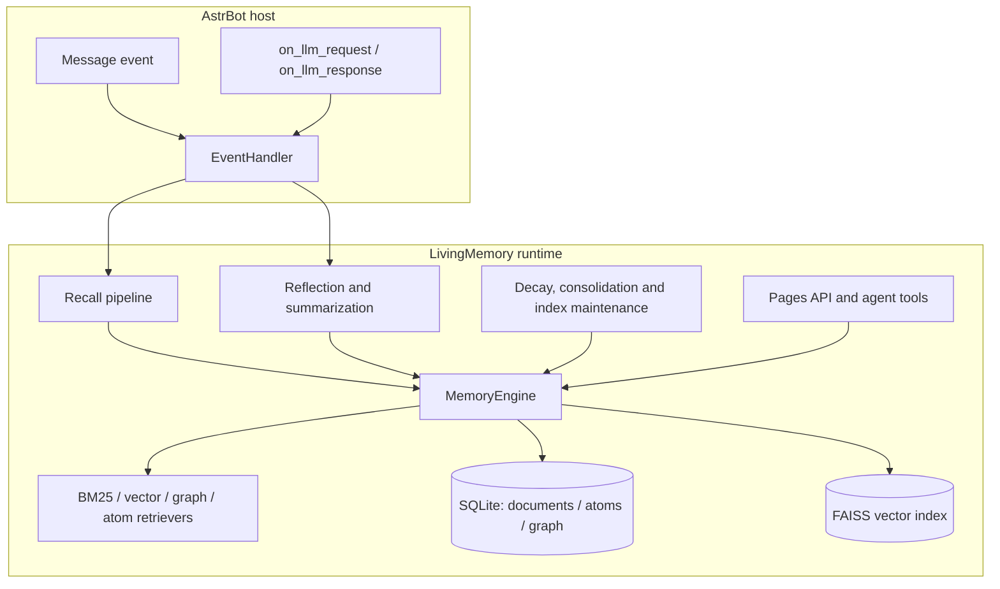
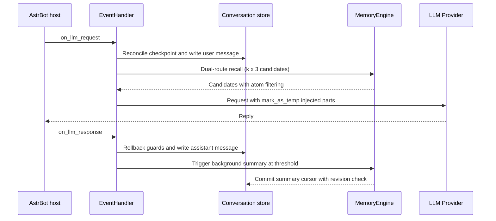
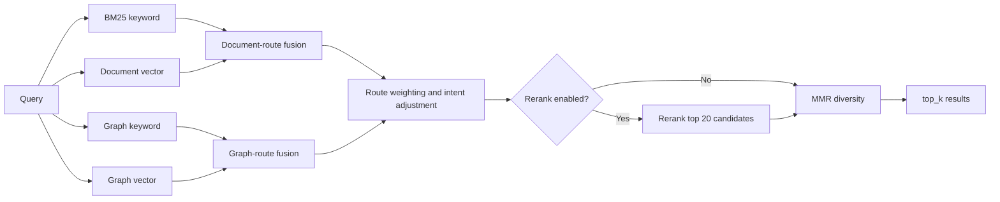
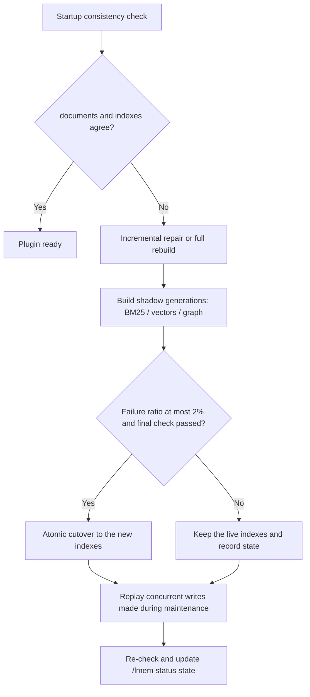

# Architecture

LivingMemory keeps automatic memory and active agent tools on one data model: conversation messages live in `ConversationStore`, long-term memories in the shared `documents` table, fine-grained facts in `memory_atoms`, and graph structures in the `graph_*` tables. Every read and write goes through the public `MemoryEngine` API. This page follows the runtime order and explains the responsibilities and trade-offs of each layer instead of only showing a module diagram.

## Runtime overview

## Layers and responsibilities

| Layer | Main implementation | Responsibility |
| --- | --- | --- |
| Plugin entry | `main.py` | Registers commands, LLM hooks and agent tools; metadata comes from `metadata.yaml`; hooks only check readiness and never block the host event loop |
| Initialization | `core/plugin_initializer*.py` | Creates FAISS and document storage, checks vector dimensions, runs database migrations, builds the engine and schedulers, then finishes consistency work in the background |
| Request pipeline | `EventHandler`, `memory_recall`, `memory_reflection` | Whitelist and scope checks, history reconciliation, recall and injection, reply capture and summarization triggers |
| Memory engine | `MemoryEngine` | Single entry point for write, search, update, delete, access statistics, decay and consolidation; exposes retrievers and the `index_writer` |
| Retrieval and fusion | `HybridRetriever`, `DualRouteRetriever`, `RRFFusion`, `GraphRetriever` | Keyword and vector recall on the document and graph routes, candidate expansion, fusion, weighting, rerank and fallback |
| Storage | `storage/` | SQLite tables and indexes, FTS, migration and version tables, FAISS persistence bridge |
| Management and observability | `pages/dashboard/`, `/lmem` commands | Pages API reuses the same engine; status reports expose initialization and index maintenance progress |

## Startup and shutdown

1. After AstrBot loads the plugin module it identifies the plugin class from `metadata.yaml`; `main.py` registers commands, LLM hooks, agent tools and the Pages API, then starts initialization.
2. Initialization runs in the background: it creates or opens the FAISS index and `documents` storage, checks vector dimensions, and routes non-ASCII paths through `faiss_path_bridge` to an ASCII temporary directory followed by an atomic replace.
3. If the database version is behind, migrations run; a backup must be created successfully before migration starts, and any failure restores that backup and aborts initialization with an explicit error.
4. `MemoryEngine` opens its connection (`PRAGMA journal_mode = WAL`, `busy_timeout = 10000`), creates the `documents` table and expression indexes, initializes the BM25, vector, graph and atom retrievers, the retrieval cache and coalesced access writes.
5. The decay scheduler starts at the configured daily hour; the startup consistency check runs as a background task, so the plugin becomes available before that work completes.
6. On shutdown the scheduler stops, tracked background tasks are cancelled and awaited with a bounded timeout, and index persisters plus database connections are closed to avoid partial flushes.

## Lifecycle of one request

1. The `on_llm_request` hook first checks readiness: while initialization is incomplete it skips recall instead of blocking the host request.
2. It checks the memory whitelist and scope visibility; when the check fails, no memory is read or written for that turn.
3. When the event carries `llm_checkpoint_id`, the plugin reconciles its conversation store with AstrBot's LLM history: rolled-back tail messages are deleted by snapshot ID, `last_summarized_index` and `pending_summary` are clamped, and the session revision is bumped.
4. Injection fragments left in history by legacy modes are removed, then the current user message is written to the conversation store.
5. With `inject_with_recent_context` enabled, the query is expanded with recent conversation; otherwise only the current message is used.
6. The retrieval cache is checked first; on a miss the dual-route recall runs, and results pass through the atom policy before formatting.
7. Memories are appended as `mark_as_temp` temporary content parts under a character budget; `extra_user_content` is the only supported injection mode and never writes into conversation history.
8. After the LLM replies, the `on_llm_response` hook applies rollback guards and records the assistant message; once unsummarized rounds reach the threshold it builds a window, captures the session revision and schedules a background summarization task.
9. The background task writes the new memory and commits the summary cursor; the revision is checked again before committing, and a cancelled task or rejected commit compensates by deleting the memory it just wrote.

## Dual-route retrieval

| Route | Keyword mode | Vector mode |
| --- | --- | --- |
| Document route | `BM25Retriever` (jieba tokens plus CJK character bigrams) | `VectorRetriever` (FAISS) |
| Graph route | `GraphKeywordRetriever` (FTS5 trigram, short terms fall back to plain matching) | `GraphVectorRetriever` |

### Candidate expansion and fusion

- The document and graph routes run in parallel; inside a route the candidate count is `k × recall_candidate_multiplier` (default 3), and at least `rerank_candidates` (default 20) when reranking is enabled.
- Routes fuse by normalized score by default: BM25 and vector scores are min-max normalized per query and combined with `fusion_bm25_weight` (default 0.5); `fusion_mode=rrf` restores rank-based fusion.
- When both routes return a document at close ranks, `fusion_agreement_bonus` (default 0.25) is added; results are then weighted by 0.5 relevance, 0.25 importance and 0.25 recency, where recency uses `importance_decay.decay_rate` (default 0.01).
- Optional Rerank processes only the top 20 fused candidates; MMR (`mmr_lambda`, default 0.7) then controls diversity before truncation to `top_k`.
- Route-level fusion starts at 0.65 for the document route and 0.35 for the graph route and adjusts to query intent: relationship terms raise the graph weight by 0.2, temporal terms by 0.1, and definition or explanation terms raise the document weight by 0.15; weights are clamped and normalized, and a memory returned by both routes receives a 0.08 cross-route bonus.
- If one route times out or fails, the other route's results are kept; a vector failure falls back to BM25, and graph-only results load full document text in a batch so empty content is never injected.

### Atom policy, cache and budgets

- Atom retrieval participates in the main recall: only atoms whose `expires_at` is in the future and whose status is active survive; an atom-backed memory injects only live facts, and a memory whose atoms are all expired is dropped instead of injecting empty text.
- The retrieval cache expires after 45 seconds and is invalidated by writes, updates and deletes; it caches document-level candidates, and the atom policy still runs on a cache hit so expired facts are never injected.
- Vector candidates expand on demand and are capped at 8192 vectors; embedding input is truncated to model limits, but full text always stays in `documents`, so inspection, export and rebuilds are unaffected.
- A single injection is capped at 6000 characters and each memory at 800 characters; graph-node substring search depends on SQLite trigram support, and queries shorter than three characters use plain matching.

## Writes and consistency

- Writes go through `MemoryIndexWriter`: the vector store is written first to obtain a doc_id, then BM25 is written with the same ID; if BM25 fails the vector write is deleted so no orphan vector remains.
- Graph memory and atoms are written next; failures there are logged and reconciled by the startup consistency check and rebuild instead of rolling back the successful main document, so one graph-index failure does not lose the whole memory.
- Source messages go to the separate `memory_sources` table as JSON and never participate in retrieval; if that write fails the newly created memory is deleted and the error is raised, keeping every memory traceable to its source.
- Deletion runs BM25 → vector → `documents`; a failed vector delete restores BM25 from the backup, and a failed document delete only warns because the primary data is already gone.
- Access statistics are not written one row at a time: the same batch of doc_ids is coalesced into one update within a three-second window, and atom access counts are coalesced separately, cutting `json_set` calls and commits.
- Sessions use revision numbers and write locks: a summarization task records the revision before reading its range, and cursor commits clamp against the current message count and compare the revision inside the store write lock; rollback or session reset invalidates the old task.

## Storage model

| Table | Purpose | Key design |
| --- | --- | --- |
| `documents` | Long-term memory text and metadata, shared with AstrBot's DocumentStorage | JSON metadata; expression indexes for session, persona, importance, status and creation time; unique `doc_id` |
| `livingmemory_memories_fts` | Document full-text search | FTS5, kept in sync with `documents` |
| `memory_sources` | Original messages behind a memory | Separate table so source text never enters retrieval or embeddings |
| `memory_atoms` | Fine-grained fact units | `ttl_days`, `expires_at`, `status`, `reinforcement_count`, `decay_type`; indexes by status, expiry and scope |
| `memory_atoms_fts` | Atom full-text search | FTS5, rows removed on expiry and forgetting |
| `graph_nodes` | Entity nodes | `node_key`, `node_type`, `canonical_value`; canonical index |
| `graph_edges` | Entity relations | Indexed by source and target node as well as source memory |
| `graph_entries` | Graph entries | Stores summaries, relation types and source memory |
| `graph_entry_nodes` | Entry-to-node mapping | Connects graph entries with nodes and supports multi-node entries |
| `graph_entries_fts` | Graph entry full-text search | FTS5 trigram for substring matching |
| `db_version` / `migration_status` | Migration version and runtime state | Version, duration, provider fingerprint and the `needs_index_rebuild` flag |
| `sessions` / `messages` | Conversation message store | Managed by `ConversationStore` and kept separate from the memory database; stores summary cursors and revisions |
| `memory_write_ops` | Legacy write-operation log | DDL is kept only for v7→v8 migration compatibility; current code never writes it |

## Concurrency model

- A single event loop per process; SQLite uses WAL and `busy_timeout = 10000`, and writes are concentrated on the one `MemoryEngine` connection, which reduces lock contention in a read-heavy workload.
- FAISS uses a readers-writer lock: searches hold a read lock in the default thread pool, while mutations and flushes hold the write lock; flushes run serially on a single-thread executor with debouncing to preserve write order.
- The conversation layer has its own session lock and store write lock: message deletion, metadata writes, revision bumps and cursor clamping happen in the same critical section.
- The cache has its own lock; invalidation and rebuild never block requests for long; background tasks are tracked in a set and their done callbacks record exceptions.
- Initialization, index rebuilds and decay scheduling are controlled background tasks; unload sets the shutdown flag first and then cancels and awaits them so no new task starts during shutdown.

## Index maintenance

- The startup consistency check compares `documents` with BM25 document counts and `documents` with the vector ID set, then triggers incremental repair or a full rebuild.
- The `memory_atoms` FTS is backfilled from missing rows during engine initialization; graph memory rebuilds run separately through `/lmem rebuild-graph` or the startup maintenance task, both reusing the same shadow-build flow.
- An embedding-provider fingerprint is stored; a provider or model change triggers a full vector rebuild even when dimensions match.
- BM25 and vectors are built into a shadow generation and switched atomically only when the failure ratio stays under 2% and the final check passes; full vector rebuilds persist checkpoints and can resume after interruption.
- Graph memory rebuilds stream active memories into shadow storage and replay writes made during the rebuild before cutover, so updates are not lost.
- On startup, migration leftovers or a host without vector deletion write the `needs_index_rebuild` flag; background maintenance consumes it and clears the flag when done.
- Maintenance state is exposed through `MemoryEngine`, and `/lmem status` reports checking, rebuilding, partially complete, failed or cancelled states with progress.

## Lifecycle and forgetting

- Summarization triggers once unsummarized rounds reach the threshold (default 10); a day change or long idle gap (default 180 minutes) splits the window so only the oldest segment is summarized and a multi-day conversation is not compressed into one memory.
- Long-term memory importance decays daily by `importance_decay.decay_rate` (default 0.01); memories accessed inside the window get a reduced effective decay based on access count, and the count itself is multiplied by 0.5 after each daily decay so an old hotspot cannot avoid decay forever.
- Atoms have type-specific TTLs: 7 days for episodes, 2 for plans, 180 for facts, 90 for relations, 60 for preferences and 30 for unknown atoms; importance and reinforcement enlarge the TTL, and decay types are linear, exponential or step.
- Atom states are active, dormant, superseded, expired and forgotten; access reinforces new atoms, expiry first soft-deletes and later cleans up, and graph plus FTS rows are updated together.
- Memory consolidation runs daily or during reflection, groups by session or semantic similarity (threshold default 0.7) and merges; the retention policy archives or deletes originals, and archived memories can be restored from the dashboard.
- Version backups are created when the plugin version changes and kept for seven days; database migration and high-risk batch operations also take a backup first.

## Scope and isolation

- Scope modes are legacy, session, user and global (`filtering_settings.memory_scope_mode`); recall, writes and migration all use the same scope resolution.
- The whitelist decides which users or sessions may capture, summarize and recall; when it rejects an event, no memory is written.
- Session, persona and status filters run inside BM25 and SQL queries before candidate truncation, so filtering cannot lose matches after limiting.
- Graph entries and atoms also carry session_id and persona_id; cross-session sharing happens only in user or global mode.

## Budgets and known limits

- Automatic recall defaults to `top_k=5` and `max_k=10`; each route has a 10-second timeout and the dual-route total is twice that plus one second.
- A single injection is capped at 6000 characters and each memory at 800; agent memory tools default to 4 calls, 20 seconds and 12000 characters of output per request.
- Embedding rebuilds default to batch size 8, concurrency 1, up to 5 retries, a 30-second exponential backoff base and 5-second request delays, which adapt to TPM rate limits.
- Known limits: asynchronous flushes are debounced, so a hard kill may lose the last flush; trigram search depends on the SQLite build; SQLite still allows a single writer, so very large imports execute serially.

## Data safety

| Scenario | Protection |
| --- | --- |
| Plugin version change | Startup creates a version-tagged backup kept for a configurable number of days |
| Database migration | Mandatory backup before migration; failure restores the backup and starts from the old database |
| Index rebuild | Shadow generations keep the live index on failure and switch atomically on success after replaying concurrent writes |
| Memory deletion | Transactional deletion of related records; a failed vector delete restores BM25 so deletion is never half-applied |
| Scope and injection | Scope is filtered before recall; injection only appends temporary parts and never writes host conversation history |
