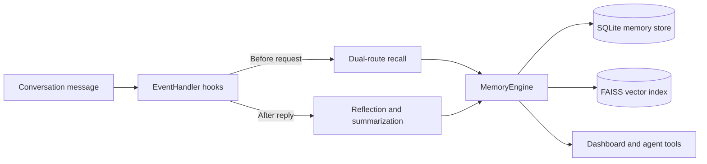

## 2.7.1 is released

2.7.1 is a patch release focused on configuration ergonomics and duplicate memories: advanced settings move from the AstrBot plugin config page to a dashboard Settings page (common panel plus five collapsed categories), and summaries get write-time near-duplicate merging. As a non-prerelease it participates in AstrBot's update prompts normally; [Releases and Upgrades](/en/releases) has the full notes, downloads and upgrade steps.

## Who is this for?

Start with [Quick Start](/en/guide/getting-started) if you want to install and use the plugin.  
Read [Features](/en/features) and [Architecture](/en/architecture) if you want to understand how the memory system stores facts, retrieves relationships, and ages older context.

::: tip Documentation scope
This site keeps the user guide, feature explanation, and architecture overview. Old phase notes, internal development docs, and outdated API drafts are intentionally left out.
:::
