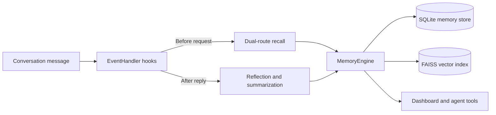

## 2.14.0 is released

2.14.0 upgrades memory quality, cross-adapter scoping, and the dashboard 3D galaxy view: it fixes atom classification, summary-parse regex fallback, graph-entry CJK bigram FTS, and passive-injection access inflation; adds a group memory blacklist, platform-independent user scoping, private-memory visibility notices, and live Embedding Provider resolution; and upgrades the 3D graph into multi-morphology galaxies with a deep-space HUD alongside an on-demand categorized Settings workspace. Public commands and database schema remain compatible. See [Releases and Upgrades](/en/releases) for downloads and upgrade steps.

## Who is this for?

Start with [Quick Start](/en/guide/getting-started) if you want to install and use the plugin.  
Read [Features](/en/features) and [Architecture](/en/architecture) if you want to understand how the memory system stores facts, retrieves relationships, and ages older context.

::: tip Documentation scope
This site keeps the user guide, feature explanation, and architecture overview. Old phase notes, internal development docs, and outdated API drafts are intentionally left out.
:::
