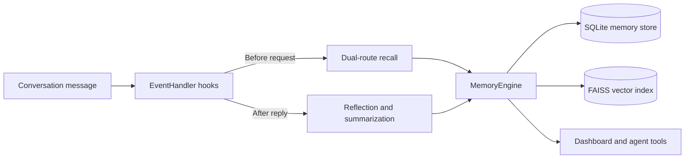

## 2.8.4 is released

2.8.4 fixes authenticated 3D graph loading, adds native SQLite error codes and database paths, and explains the host upgrade for timestamp write failures. Plugin Views require AstrBot 4.24.2 or later; the timestamp fix requires host version 4.29.0 or later. See [Releases and Upgrades](/en/releases) for downloads and instructions.

## Who is this for?

Start with [Quick Start](/en/guide/getting-started) if you want to install and use the plugin.  
Read [Features](/en/features) and [Architecture](/en/architecture) if you want to understand how the memory system stores facts, retrieves relationships, and ages older context.

::: tip Documentation scope
This site keeps the user guide, feature explanation, and architecture overview. Old phase notes, internal development docs, and outdated API drafts are intentionally left out.
:::
