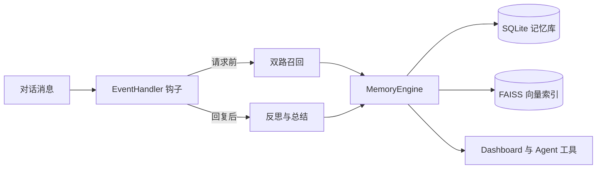

## 2.7.1 已发布

2.7.1 补丁版聚焦配置体验与重复记忆：高级配置从 AstrBot 插件配置页迁移到 Dashboard 设置页（常用设置 + 5 类折叠分组），并新增写入时近重复合并。稳定版会正常参与 AstrBot 的版本更新提示；[版本与升级](/releases)提供完整说明、下载与升级步骤。

## 这份文档适合谁？

如果你只是想装好插件并让 AstrBot 拥有长期记忆，从 [快速开始](/guide/getting-started) 读起。  
如果你想理解为什么它能同时处理事实、关系、偏好和旧记忆衰减，直接看 [功能说明](/features) 和 [技术架构](/architecture)。

::: tip 文档范围
这里保留的是面向使用、配置、功能理解和架构说明的内容。旧版本阶段总结、内部开发记录和过期 API 草稿已经不再放进文档站。
:::
